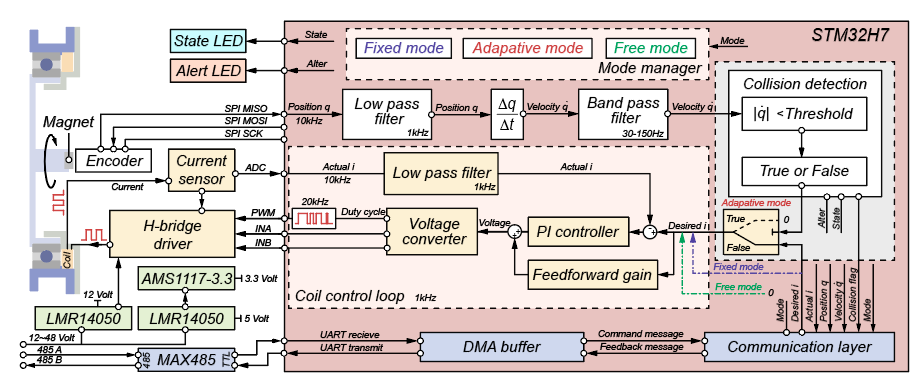

# SafeMRC

**[English](README.md)** | **[中文](README_CN.md)**

> Embedded controller firmware for Magnetorheological Fluid (MRF) clutch / bearing lock devices, built on STM32H7.

[](LICENSE)


<p align="center">
  
</p>

## Features

- **Dual Control Modes** - Voltage control and coil current control (feedforward + PI) with smooth switching
- **Real-Time Collision Detection** - Automatic demagnetization on collision for safety
- **Dual Communication Backend** - RS-485 (4 Mbps) and Classic CAN (1 Mbps), selectable at compile-time
- **State Machine** - FREE / FIX_LIMIT / ADAPTATION / DEBUG modes with safe transitions
- **PWM Nonlinearity Compensation** - LUT + interpolation for accurate low-voltage H-bridge output
- **Comprehensive Filtering** - Moving average, low-pass, Kalman, and band-pass filters
- **Flash Persistence** - Device ID and coil resistance survive power cycles
- **Debug CLI** - Interactive UART1 shell for testing and calibration
- **Python Host Tool** - Cross-platform GUI with real-time plotting and data export

## Quick Start

### Prerequisites

- CMake 3.22 or newer and [Ninja](https://ninja-build.org/)
- GNU Arm Embedded toolchain (`arm-none-eabi-gcc`, `objcopy`, `size`)
- [STM32CubeMX](https://www.st.com/en/development-tools/stm32cubemx.html) (for peripheral config)
- ST-Link programmer; [OpenOCD](https://openocd.org/) or `st-flash` for command-line flashing

The original Keil MDK project under `MDK-ARM/` remains available as a fallback. It is not required for the Linux build.

### Build & Flash

```bash
# Configure the CubeMX-generated RS-485 Debug preset
cmake --preset Debug

# Build ELF, HEX, BIN, and MAP files
cmake --build --preset Debug
cmake --build --preset Debug --target size

# For CAN, configure a separate build directory with the same CubeMX toolchain
cmake -S . -B build/CAN -G Ninja \
  -DCMAKE_TOOLCHAIN_FILE=cmake/gcc-arm-none-eabi.cmake \
  -DCMAKE_BUILD_TYPE=Debug \
  -DMRC_COM_BACKEND=CAN
cmake --build build/CAN

# Flash with OpenOCD (verifies and resets the target)
cmake --build --preset Debug --target flash

# Or use the st-flash fallback
cmake --build --preset Debug --target flash-stlink
```

For normal development, use the build wrapper instead of typing the CMake
commands manually. It performs an incremental build by default; pass
`--full` when every object should be rebuilt:

```bash
scripts/build.sh
scripts/build.sh --full
scripts/build.sh --backend CAN --full
scripts/build.sh --backend RS485 --config Release --jobs 8
```

The wrapper configures CMake when a build directory is new (or when `--full` is
selected), then builds and prints the firmware size. Existing incremental
builds let Ninja decide whether CMake regeneration is needed. It uses separate
directories such as `build/RS485-Debug/` and `build/CAN-Debug/` so switching
backends does not reuse incompatible objects.

The direct `cmake --preset Debug` commands place generated files in
`build/Debug/`; the wrapper uses its selected directory such as
`build/RS485-Debug/`. The `flash` target uses
`interface/stlink.cfg` and `target/stm32h7x.cfg` by default. To use different
OpenOCD configuration files, invoke the script directly:

```bash
scripts/flash_openocd.sh build/Debug/safeMRC_for_DM_firmware.elf \
  interface/my_probe.cfg target/stm32h7x.cfg
```

`openocd` programs and verifies only the sectors covered by the ELF image; it
does not perform a chip erase by default. ST-Link tools may require adding the
user to the distribution's `plugdev` group or installing an ST-Link udev rule.
If the installed `st-flash` does not support `reset`, reset the board with the
probe or power cycle after the write.

### GitHub Actions CI/CD

Pull requests and branch pushes run the hosted workflow in
`.github/workflows/firmware-ci.yml`. It builds all four combinations of RS485
and CAN with Debug and Release configurations, checks the ELF/HEX/BIN/MAP
outputs, and uploads them as short-lived workflow artifacts. Pushing a tag such
as `v1.0.0` also creates a GitHub Release containing the RS485 and CAN Release
artifacts with generated release notes.

The hosted workflow does not flash a physical board because GitHub-hosted
runners do not have the project's ST-Link or OpenOCD target connected. Use the
local `flash` or `flash-stlink` targets after downloading a verified artifact.

For a GDB session, start the OpenOCD server in one terminal:

```bash
openocd -f interface/stlink.cfg -f target/stm32h7x.cfg
```

Then connect from another terminal:

```text
arm-none-eabi-gdb build/Debug/safeMRC_for_DM_firmware.elf
(gdb) target extended-remote :3333
(gdb) monitor reset halt
(gdb) load
(gdb) monitor reset
(gdb) continue
```

VS Code users can install Cortex-Debug and use this optional launch
configuration without making VS Code part of the build:

```json
{
  "name": "SafeMRC (OpenOCD)",
  "type": "cortex-debug",
  "request": "launch",
  "cwd": "${workspaceFolder}",
  "executable": "${workspaceFolder}/build/Debug/safeMRC_for_DM_firmware.elf",
  "servertype": "openocd",
  "configFiles": ["interface/stlink.cfg", "target/stm32h7x.cfg"],
  "runToEntryPoint": "main"
}
```

### CubeMX regeneration

`safeMRC_for_DM_firmware.ioc` remains the source of truth for the MCU, clock
tree, GPIO, DMA, and peripheral configuration. CubeMX now generates
`CMakePresets.json`, `cmake/gcc-arm-none-eabi.cmake`, and
`cmake/stm32cubemx/CMakeLists.txt` in this project. The top-level
`CMakeLists.txt` consumes that generated source list and adds the application
layer under `Common/` and `Devices/`.

The generated CubeMX linker script and startup file are kept for reference, but
the top-level build selects the maintained GCC startup and linker script because
the firmware uses a dedicated `RAM_D2` section for DMA buffers. CubeMX may
regenerate its files; do not remove the hand-maintained `cmake/STM32H723VGHx.ld`
or `startup/startup_stm32h723xx_gcc.s` files.

After every CubeMX generation:

1. Enable backup and keep-user-code options before generating.
2. Review `git diff` and keep generated changes limited to CubeMX-owned files (`Core/`, `Drivers/`, `cmake/stm32cubemx/`, presets, and generated toolchain files).
3. Reconfigure with `cmake --preset Debug` and build both `RS485` and `CAN` backends.
4. Inspect the map file, then flash and run the hardware smoke tests before committing.

The Keil fallback remains available:

```text
MDK-ARM/safeMRC_for_DM_firmware.uvprojx

# Build with F7 and flash through the Keil debugger or STM32CubeProgrammer.
```

### Host Python Tool

```bash
conda env create -f scripts/environment.yml
conda activate safemrc_host
python scripts/main.py
```

Requires a USB-RS485 adapter at up to 4 Mbps. See [scripts/README.md](scripts/README.md) for details.

### Python SDK Quick Example

```python
from safeMRC_sdk import SafeMRC, SafeMRCCmd, SafeMRCData

mrc = SafeMRC('/dev/ttyUSB0')
cmd = SafeMRCCmd(mode=1, current=0.5)
fbk = SafeMRCData()

if mrc.sendRecv(cmd, fbk):
    print(f"angle={fbk.encoder:.3f}, current={fbk.current:.3f}")
```

## Architecture

```
Core/           HAL-generated peripheral init (CubeMX output)
Common/         Reusable utilities: PID, filters, flash, sys_clock
Devices/        MRC application drivers (primary logic layer)
Applications/   Callbacks wiring HAL interrupts to device logic
scripts/        PC-side Python UI + SDK
```

**Timing:** TIM6 @ 1 kHz drives the state machine and feedback TX. TIM4 @ 10 kHz drives the coil current control loop and communication processing.

**Single global instance:** All application code operates on one `Device_MRC_t MRC` declared in `main.c`. No RTOS - concurrency is managed via ISR-set flags polled in the main loop.

## Communication

Two backends are available, selected at compile-time via `Devices/Inc/mrc_com_backend.h`:

| Backend | Bus | Baudrate | Frame Size | Error Check |
|---------|-----|----------|------------|-------------|
| RS-485  | USART2 | 4 Mbps | CMD: 10 B, FBK: 17 B | CRC-16-CCITT |
| CAN     | FDCAN1 | 1 Mbps | CMD: 8 B, FBK: 8 B | Hardware CRC |

Both use a request-response pattern: host sends a command, device replies with feedback containing encoder position, velocity, current, and collision status.

## Documentation

| Document | Description |
|----------|-------------|
| [RS-485 Protocol](docs/protocol-rs485.md) | Frame format, byte layout, CRC, mode definitions |
| [CAN Protocol](docs/CAN_Protocol_Handoff.md) | CAN ID scheme, frame layout, SocketCAN examples |
| [API Reference](docs/api-reference.md) | Device struct, control functions, filters, timers |
| [Debug CLI & Flash](docs/debug-cli.md) | UART1 CLI commands, flash persistence |
| [Troubleshooting](docs/troubleshooting.md) | Common issues, safety features, debug output |
| [Python Host Tool](scripts/README.md) | GUI setup, SDK usage, data export |

## Contributing

1. Fork the repository
2. Create a feature branch (`git checkout -b feature/my-feature`)
3. Commit your changes using the [commit message standard](dev_docs/standards/commit-message.md) (`TYPE:`, `WHY:`, `WHAT:`, `TEST:`)
4. Push to the branch (`git push origin feature/my-feature`)
5. Open a Pull Request

Working notes, migration records, and collaboration standards are indexed in
[dev_docs](dev_docs/README.md).

## License

This project is licensed under the [MIT License](LICENSE).

## Acknowledgments

Developed at the University of Science and Technology of China (USTC).
